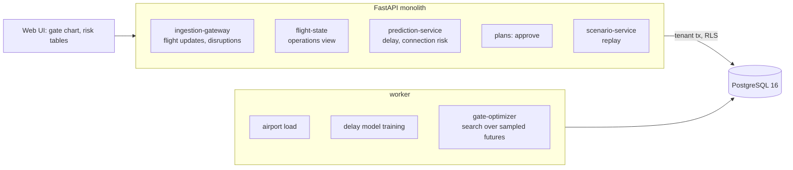

# Autonomous Airport Operations Intelligence System

For a hub airport's operations centre: it predicts how late each inbound aircraft will be, how many connecting passengers that
puts at risk, and which aircraft will find their gate still occupied; it proposes a new gate plan and a rule for holding departures,
which a manager has to approve; and it replays the evening as it really went to show what each choice was worth.

Built from blueprint 1 of "Advanced Engineering Build Book, Volume III" as a **vertical slice**: the demo scenario end to end,
with the platform parts real and the rest listed under [Not built](#not-built-and-why).

**The airport, its timetable, its passengers and the day's delays come from a simulator in this repository. The replay uses the
simulator's hidden version of the day. Passenger-minute prices are my assumptions.**

## Run it

```bash
docker compose up --build        # migrates, seeds, serves http://localhost:8211/ui/ with one worker
docker compose run --rm test     # 17 tests against a throwaway database (about 35 s)
```

Open http://localhost:8211/ui/ and press **Run all steps** (about 30 seconds; the two plans take 12 seconds each), or `make bootstrap demo`.
Demo tokens (local only): `hub-manager-demo`, `hub-controller-demo`, `hub-viewer-demo`. Run `make reset` before a second demo run.

## The demo, step by step

1. 16:00 at an invented hub: 28 gates (14 international), 292 aircraft turns in the day, 38,624 passengers of whom 14,371 connect. 173 aircraft have left, 23 are at a gate, 62 are in the air, 34 have not left their origin. A delay model is trained on 72 past days and tested on 18: error 4.7 minutes against 5.2 for the departures board; in a storm queue 6.0 against 7.1.
2. The gate chart for the next six hours: with nothing announced, 6 aircraft are expected to wait for a gate.
3. Houston posts a 75-minute delay for RB351. Its estimate moves from 18:56 to 20:07. The same update resent with an older timestamp is ignored.
4. A thunderstorm is announced from the forecast: 16:00 to 17:30, landings cut to 18 an hour and pushbacks to 12. Aircraft expected to wait for a gate go from 6 to 28, gate waiting from 66 to 352 aircraft-minutes, expected missed connections from 222 to 278.
5. RB351's 58 connecting passengers: each onward flight with its minutes to spare and chance of being missed; 30.6 expected to miss.
6. The optimiser proposes 2 gate changes and a 15-minute hold rule, judged on six sampled versions of the evening. The controller who asked for it is refused permission to publish it; a manager approves.
7. RB340 is locked to gate B1 and the plan is redone around it; approved.
8. The replay, 96 aircraft after 16:00, with the storm really lasting until 17:55. Scheduled gates: 229 missed connections. Scheduled gates with holds: 203 (9 departures held, 34 minutes in all). Plan 1: 210. Plan 2, with the lock: 266 and 84 more minutes of waiting. First free gate on arrival: 239 and 66 last-minute gate changes.
9. The audit log.

What step 8 says is the honest result of this build: holding departures for passengers whose aircraft is already at a gate
saves connections; re-assigning gates in a storm does not, because every gate is full and the plan only decides who waits.
A VIP lock has a price, and the system shows it.

## Architecture



| Piece | How it works |
|---|---|
| Simulator (`ap/world.py`) | A timetable of about 290 turns in waves, each with an aircraft size, origin, passengers and a gate plan that fits (size, international). Passengers connect between flights with at least 5 minutes to spare at schedule. A day draws each aircraft's delay leaving its origin, then queues landings at the runway rate; in a storm the rate drops and pushbacks are metered, so aircraft sit on their gates. |
| Delay model | Gradient-boosted trees (median loss, with 10% and 90% quantile models) on: delay leaving the origin if known, time of day, where the expected landing falls in the storm forecast, how many aircraft are expected ahead in the storm queue, and traffic density. Each training flight is seen from a random 30 to 180 minutes out. |
| Connection risk | The chance that an inbound aircraft's real delay exceeds the minutes to spare, taken from how wrong test-day predictions of that size were. Calibration is measured in the evaluation. |
| Gate operations (`engine.operate`) | An event simulator: arrivals, gates freeing, pushbacks metered in a storm, a connecting-passenger hold decided when a departure is ready. It scores any plan, and it is what the optimiser searches with. |
| Gate optimiser | Hill climbing over gate moves and swaps for aircraft still to arrive, each candidate scored on six sampled futures (delay errors drawn from the test residuals, storm length from past overruns). Cost in passenger-minutes: waiting for a gate, departing late, a gate change at 3 minutes a head, a missed connection at 90. |
| Approval | A plan is a proposal until a manager approves it; a proposal computed against a plan that has since been replaced is refused as stale. |
| Platform | Row-level security per airport, Postgres job queue, Idempotency-Key replay, hash-chained audit log, `/metrics`. |

## Data model

`migrations/002_airport.sql` follows the blueprint (airports, flights, gates, gate_assignments, disruptions, predictions); additions
are marked `(+)`: connections, delay_models, plans, and on each flight what is known so far. Pier and slot numbers stand in for PostGIS
geometry. Not created: turnaround_tasks, resources.

## API

| Method | Endpoint | Purpose |
|---|---|---|
| POST | `/v1/events/flight-update` | A flight's delay at its origin; older observations are ignored |
| GET | `/v1/airports/{id}/operations?window=6h` | Every flight's estimate, gate, expected wait and hold; connections at risk |
| POST | `/v1/optimizations/gates` | 202 + job: propose gates and a hold rule, with locks |
| POST | `/v1/scenarios` | Replay the evening as it really went under each plan |
| GET | `/v1/flights/{id}/connection-risk` | Each onward connection's minutes to spare and chance of being missed |
| POST | `/v1/airport:load` | (+) 202 + job: load a synthetic airport at 16:00 |
| POST | `/v1/models/delay:train` | (+) 202 + job: train, test, estimate |
| POST | `/v1/disruptions` | (+) Announce a storm from its forecast; outlook before and after |
| POST | `/v1/plans/{id}/approve` | (+) Manager publishes a proposal |
| GET | `/v1/plans/{id}` | (+) A proposal and its status |

Contract: [`docs/openapi.json`](docs/openapi.json). `POST /v1/optimizations/resources` and the WebSocket stream are not built.

## Measured

[`docs/evaluation.md`](docs/evaluation.md) (`python -m ap.evaluate`, three airports and nine storm evenings the demo never uses) and
[`docs/performance.md`](docs/performance.md).

| Component | Result | Baseline |
|---|---|---|
| Delay error, airports 101 and 102 | 4.2 min; 4.3 to 5.0 in a storm queue | departures board: 4.5; 5.1 to 5.8 |
| Delay error, airport 103 | 4.9 min; 7.5 in a storm queue (worse) | 4.7; 6.4 |
| Outcomes inside the 10–90% band | 79% to 80% | 80% is perfect |
| Connection risk, groups given 10–30% | 17% missed | predicted 16% |
| Connection risk, groups given 90%+ | 87% missed | predicted 99% (too sure) |
| Missed connections, 9 evenings | holds: 2,148 | scheduled gates: 2,796; first free gate: 3,190 |
| Missed connections with new gates + holds | 2,212 | perfect knowledge of arrivals + holds: 2,168 |
| Passenger-minute cost with new gates + holds | 4.3% lower | perfect knowledge: 7% lower |

Three things these numbers say plainly. The hold rule is the part that works. The gate optimiser lowers the cost it is given but
not the missed connections, and even perfect knowledge of arrival times gains little, because a full airport leaves a gate plan
little room. On one of three airports the delay model was worse than the departures board, and I could not find out why; a model
that can lose to the board needs a check against it before it is trusted, and this slice has none.

## The hardest tradeoff

My first optimiser was the CP-SAT model the blueprint asks for: one interval per aircraft per gate, no overlaps, waiting and
changes in the objective. On point estimates it found plans in a second that looked 4% better, and in the replay they were 2 to 6%
worse than doing nothing: a plan packed tightly around estimates that are 7 minutes off breaks on contact. The fix was to stop
trusting one estimate. The search now scores every candidate on six sampled futures through the same simulator that scores the
real day, so a change is kept only if it helps on average. That made the plans safe, and also showed how little room there was:
the gate waiting is caused by aircraft that cannot push back, and no gate assignment changes that. The lever that worked was
elsewhere, in holding departures a few minutes for passengers already in the terminal, so that is what the slice ships.

## Threat model (summary)

| Threat | Mitigation here | Gap |
|---|---|---|
| A plan published without a human | Proposals are inert; only a manager role can approve, and the controller who requested a plan cannot | One manager click; no second approver for large changes |
| Acting on a stale proposal | Approval is refused when another plan was published after the proposal was computed | |
| Replayed or out-of-order flight updates | An update older than the one stored is ignored; Idempotency-Key replay returns the stored response | No signing of the update source |
| One airport seeing another's operations | Row-level security on every table; tested through the API and directly in the database | |
| Trusting a delay model that is wrong today | The API returns the 10–90% band with every estimate, and the replay reports the model's error beside the board's | No automatic fallback to the board when the model is worse |

## Not built, and why

- **Real feeds** (AODB/FIDS, ADS-B, ACARS, METAR): flight updates arrive over HTTP; the day is generated. The service also rebuilds the timetable from the generator's seed rather than from the stored rows.
- **Turnaround milestones and ground resources** (cleaning, fuelling, crews, equipment): not started; a turn is one duration by aircraft size.
- **Baggage misconnect risk**: not started; the slice covers passengers only.
- **The CP-SAT gate model**: built, measured, and removed (see the tradeoff above). Remote stands, towing and rolling re-planning are not modelled.
- **Delays caused by anything but the origin and the runway**: no crew, maintenance or air-traffic-flow delays in the generator.
- **A live clock**: the demo stands at 16:00 and replays the evening; there is no stream of events moving time forward.
- **Kafka, Redis, OpenTelemetry, Grafana, MLflow, Terraform, CI, SSO, a Next.js front end**: not needed to prove the slice; no cloud account used.

## Commercial sketch

Buyer: airport operators and hub control centres. Pricing shape from the blueprint: annual subscription by airport size with an
implementation fee, and a per-flight optimisation tier.

## Layout

```
core/        platform kit: db + RLS, jobs, audit chain, HTTP, scenario runner, load test
ap/          world (airport, day, history), engine (delay model, risk, gate operations, optimiser), api, seed, evaluate
migrations/  forward-only SQL          web/   UI, scenario.json, demo.json (recorded run)
tests/       17 tests                  docs/  evaluation.md, performance.md, openapi.json
```
